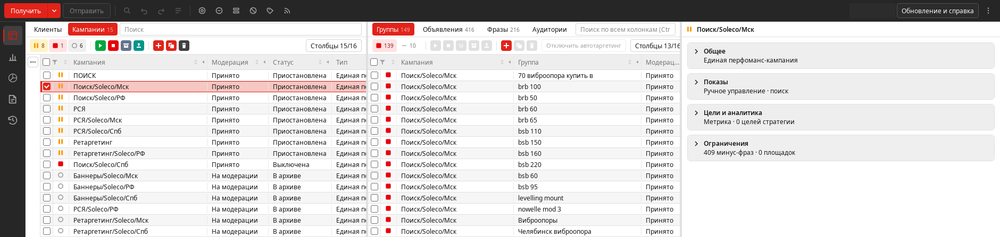
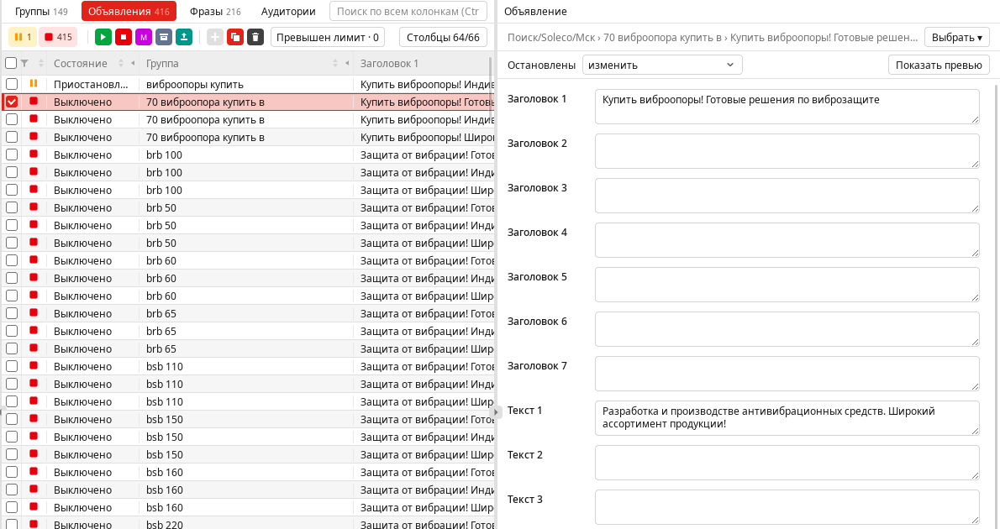
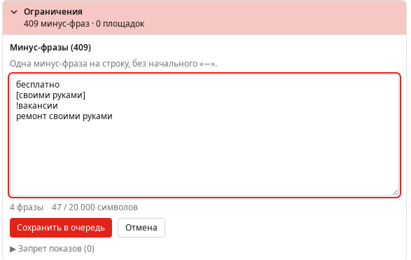

<p align="center">
  
</p>

<h1 align="center">Yandex Turbo Commander</h1>

<p align="center">
  Настольный менеджер Яндекс Директа для массовой работы с кампаниями,<br>
  локального редактирования, проверки изменений и управляемой отправки в Direct API.
</p>

> [!IMPORTANT]
> Turbo Commander находится в активной разработке и не является официальным
> продуктом Яндекса. Перед работой с боевым аккаунтом проверяйте подготовленный
> дифф и используйте тестовое подключение для новых сценариев.




## Скачать

[Последний выпуск для Linux и Windows](https://github.com/visualklik/yandex-turbo-commander/releases/latest).

Linux x64 — AppImage. Windows x64 — установщик EXE. В описании выпуска
есть инструкции установки, результаты проверок и контрольные суммы SHA-256.

## Что такое Turbo Commander

Turbo Commander загружает рекламный аккаунт в локальную SQLite-базу и даёт
работать с кампаниями, группами, объявлениями, фразами и аудиториями в едином
табличном интерфейсе. Большинство изменений сначала попадает в локальную
очередь: пользователь видит, что именно будет отправлено, может применить
Undo/Redo и только затем нажать «Отправить».

Приложение построено на React 19, TypeScript, Rust и Tauri 2. Основная рабочая
платформа разработки — Linux. Доступны AppImage для Linux и EXE для Windows.

## Основные возможности

- Таблицы кампаний, групп, объявлений, фраз и аудиторий с поиском, фильтрами, массовой правкой и настройкой порядка столбцов.
- Инспектор кампании с разделами «Общее», «Показы», «Цели и аналитика» и «Ограничения».
- Локальная очередь с предпросмотром «Что уйдёт», выборочной отменой и Undo/Redo. Быстрые ссылки, уточнения, корректировки ставок и поддерживаемые операции с аудиториями проходят через эту очередь.
- Редактирование минус-фраз и списков площадок. Из отчёта по поисковым запросам можно добавить в очередь весь запрос или выбранные слова на уровне кампании или группы.
- Месячная статистика, аналитические срезы, быстрые отчёты по запросам, площадкам и фразам.
- История принятых Директом изменений по каждому аккаунту с группировкой по дням, фильтрами и экспортом в TXT.
- Прямые и агентские подключения, восстановление последнего загруженного списка кампаний и управление размером кэша по аккаунтам.
- Кросс-минусовка, склейка дублей и проверка наличия показов фраз. Счётчики длины заголовков и текстов с подсветкой превышений в таблице.

## Turbo Commander и Яндекс Директ Коммандер

Сравнение для **Turbo Commander 0.1.3** по [официальной справке настольного Директ Коммандера](https://yandex.ru/support/direct-commander-new/ru/).
Для отчётов и истории ссылки ведут на соответствующие разделы веб-Директа.

| Сценарий | Яндекс Директ Коммандер | Turbo Commander 0.1.3 |
| --- | --- | --- |
| Платформы | [Windows и macOS](https://yandex.ru/project/commander/new) | Linux x64 (AppImage) и Windows x64 (EXE) |
| Получить данные и редактировать локально | [Получение списка кампаний и данных выбранных кампаний](https://yandex.ru/support/direct-commander-new/ru/general/download) | Быстрая и полная загрузка. Последний загруженный список кампаний хранится по аккаунтам |
| Массовое редактирование | [Редактирование в таблице и Инспекторе, поиск и замена](https://yandex.ru/support/direct-commander-new/ru/editing/tools) | Правки в таблице и Инспекторе, поиск и замена, настройка видимости и порядка столбцов |
| Проверить и отправить изменения | [Индикаторы готовности и ошибок. Отправка всех данных, ставок или параметров кампаний](https://yandex.ru/support/direct-commander-new/ru/general/upload) | Панель «Что уйдёт» показывает локальные правки перед отправкой. Есть Undo/Redo и выборочная отмена |
| Копировать кампании, группы и объявления | [Внутри аккаунта и между клиентами](https://yandex.ru/support/direct-commander-new/ru/editing/copy-paste) | Внутри аккаунта, для поддерживаемых типов |
| Импорт и экспорт | [Создание и обновление объектов из файла или буфера](https://yandex.ru/support/direct-commander-new/ru/advanced/import) и [экспорт](https://yandex.ru/support/direct-commander-new/ru/advanced/export) | XLSX-экспорт в формате Коммандера, импорт поддерживаемых правок в существующие объекты и CSV-экспорт |
| Расширить семантику | [Подбор фраз по данным Wordstat](https://yandex.ru/support/direct-commander-new/ru/keywords/wordstat) | Встроенного подбора через Wordstat нет. Есть проверка наличия показов для загруженных фраз |
| Убрать дубли и пересечения ключевых фраз | [Кросс-минусовка и склейка дублей с предпросмотром](https://yandex.ru/support/direct-commander-new/ru/keywords/deduplicate) | Кросс-минусовка и склейка дублей с проверкой изменений перед применением |
| Массово изменить ставки | [Мастер ставок](https://yandex.ru/support/direct-commander-new/ru/keywords/bids-wizard) | Редактирование ставок для поддерживаемых стратегий. Мастера ставок с формулами нет |
| Обновить быстрые ссылки объявлений | [Массовое редактирование на уровне объявлений](https://yandex.ru/support/direct/ru/efficiency/quick-links) | Редактор общих ссылок выбранных объявлений, библиотека заготовок и отправка через очередь |
| Добавить минус-фразы из фактических запросов | [Отчёт «Поисковые запросы» в веб-Директе](https://yandex.ru/support/direct/ru/statistics/library/search-queries) | Встроенный отчёт. Можно выбрать запрос целиком или отдельные слова и добавить в очередь кампании или группы |
| Посмотреть историю изменений | [История изменений кампаний за 90 дней в веб-Директе](https://yandex.ru/support/direct/ru/campaigns/logs) | Локальная история операций, отправленных из приложения и принятых Директом. Поиск, группировка по дням и экспорт TXT |

Поддержка редакторов зависит от типа кампании, объявления и стратегии. Отдельные товарные сценарии, промоакции, бизнес-профили и профили интересов покрыты частично. Для Windows выпущен неподписанный установщик. Версию 0.1.3 проверили при обновлении в Wine, а чистая установка в Wine завершилась ошибкой. Тест на Windows пока не проводился. Подробности есть в [описании выпуска](https://github.com/visualklik/yandex-turbo-commander/releases/tag/v0.1.3).

## Скриншоты

В начале страницы показаны кампании и группы Soleco. Ниже показаны редакторы объявлений и минус-фраз. Идентификаторы и бюджет скрыты. В редакторе минус-фраз введён демонстрационный список.

### Редактор объявлений



### Минус-фразы кампании



## Как устроена работа с изменениями

```text
Direct API → серверный слепок → локальная рабочая копия → дифф → Отправить → Direct API
```

Правки полей, создание, копирование и поддерживаемые операции со статусами
сохраняются в локальной очереди до нажатия «Отправить».

Отдельные операции с ресурсами аккаунта выполняются сразу. К ним относятся
загрузка медиафайлов в библиотеку, создание общих наборов минус-фраз и работа
с фидами. Назначение медиа объявлению и привязка готового набора минус-фраз
попадают в очередь.
