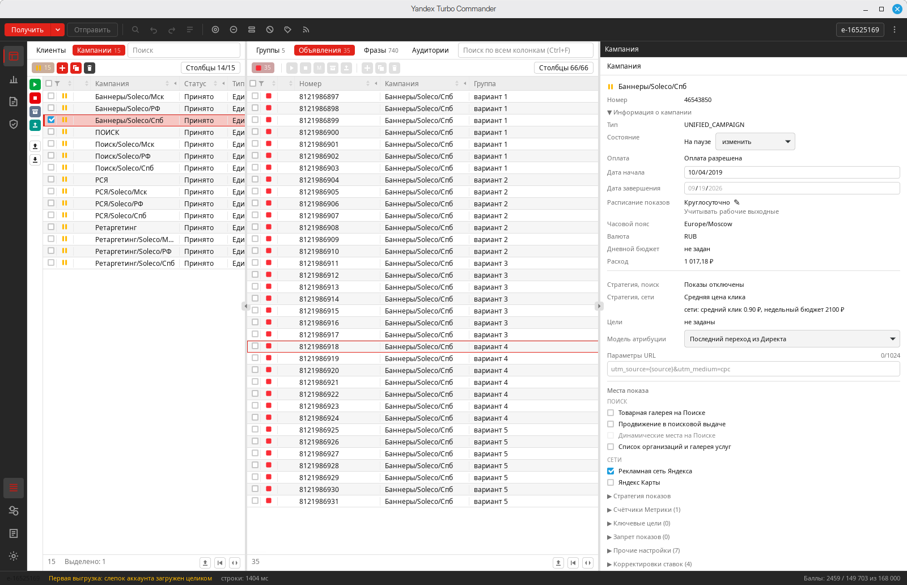

<p align="center">
  
</p>

<h1 align="center">Yandex Turbo Commander</h1>

<p align="center">
  Настольный менеджер Яндекс Директа для массовой работы с кампаниями,<br>
  локального редактирования, проверки изменений и управляемой отправки в Direct API.
</p>

> [!IMPORTANT]
> Turbo Commander находится в активной разработке и не является официальным
> продуктом Яндекса. Перед работой с боевым аккаунтом проверяйте подготовленный
> дифф и используйте тестовое подключение для новых сценариев.




## Скачать

[Последний выпуск для Linux и Windows](https://github.com/visualklik/yandex-turbo-commander/releases/latest).

Linux x64 — AppImage. Windows x64 — установщик EXE. Описание выпуска содержит
проверки, ограничения и контрольные суммы SHA-256. macOS-пакет пока не опубликован.

## Что такое Turbo Commander

Turbo Commander загружает рекламный аккаунт в локальную SQLite-базу и даёт
работать с кампаниями, группами, объявлениями, фразами и аудиториями в едином
табличном интерфейсе. Большинство изменений сначала попадает в локальную
очередь: пользователь видит, что именно будет отправлено, может применить
Undo/Redo и только затем нажать «Отправить».

Приложение построено на React 19, TypeScript, Rust и Tauri 2. Основная рабочая
платформа разработки — Linux; CI также компилирует проект для Windows и macOS.

## Основные возможности

- массовые таблицы кампаний, групп, объявлений, фраз и аудиторий;
- локальный серверный слепок и отдельная рабочая копия данных;
- очередь изменений с предпросмотром, выборочной отменой, Undo и Redo;
- массовая правка через Инспектор, поиск и замена, сортировка и фильтры;
- создание и копирование кампаний, групп, объявлений и ключевых фраз;
- стратегии, бюджеты, расписание, места показа, цели Метрики и параметры URL;
- автотаргетинг, ретаргетинг, интересы и привычки для поддерживаемых профилей;
- региональные корректировки с массовым сценарием `−90%` вне географии групп;
- минус-фразы, наборы минус-фраз и списки запрещённых площадок;
- кросс-минусовка, склейка дублей и прогноз наличия показов фраз;
- быстрые ссылки, уточнения, изображения, видео, кнопка и цена объявления;
- XLSX-экспорт в формате Коммандера, импорт правок и CSV;
- отчёты по кампаниям, площадкам, поисковым запросам и фразам;
- журнал запросов Direct API, расход Units и локальные диагностические проверки;
- прямые и агентские подключения, переключение сохранённых аккаунтов;
- системное хранилище OAuth-токенов и резервные копии SQLite перед миграциями.

## Turbo Commander и Яндекс Директ Коммандер

Сравнение ниже отражает текущее состояние проекта на **19 сентября 2026 года**.
`Частично` означает, что основной сценарий есть, но покрыты не все типы объектов
или отсутствует подтверждённый end-to-end тест.

| Возможность | Директ Коммандер | Turbo Commander |
|---|:---:|:---:|
| Получение аккаунта и офлайн-редактирование | ✅ | ✅ |
| Кампании → группы → объявления/фразы | ✅ | ✅ |
| Массовая правка и поиск/замена | ✅ | ✅ |
| Настраиваемые таблицы, сортировка и фильтры | ✅ | ✅ |
| Undo и Redo | ✅ | ✅ |
| Явная очередь диффа до отправки | Не подтверждено | ⭐ ✅ |
| Инкрементальная загрузка по метке изменений | Частично | ⭐ ✅ |
| Создание кампаний всех поддерживаемых типов | ✅ | Частично |
| Копирование кампаний, групп и объявлений | ✅ | ✅ |
| Копирование между клиентами/аккаунтами | ✅ | ❌ |
| Стратегии, бюджет, расписание и места показа | ✅ | ✅ |
| Массовые региональные корректировки вне географии групп | Не подтверждено | ⭐ ✅ |
| Автотаргетинг, ретаргетинг и аудитории | ✅ | ✅ |
| Редактор интересов и привычек | ✅ | Частично |
| Подбор фраз по Wordstat | ✅ | ❌ |
| Мастер ставок с формулами и ограничениями | ✅ | ❌ |
| Кросс-минусовка и склейка дублей | ✅ | ✅ |
| Проверка наличия показов с географией группы | Не подтверждено | ⭐ ✅ |
| Быстрые ссылки, уточнения и медиадополнения | ✅ | ✅ |
| Встроенные отчёты и блокировка площадок из отчёта | Не подтверждено | ⭐ ✅ |
| Журнал запросов/ответов Direct API | Не подтверждено | ⭐ ✅ |
| Linux | Официально не заявлен | ⭐ ✅ |
| XLSX/CSV импорт и экспорт | ✅ | Частично |
| Публично проверенные установщики | ✅ | Пока нет |

## Что пока ограничено

- нет подбора и расширения фраз через Wordstat;
- нет мастера ставок с формулами изменения и потолком ставки;
- нет межаккаунтного переноса объектов;
- импорт не создаёт произвольную новую кампанию из всех форматов Коммандера;
- редакторы бизнес-профиля, промоакций и части товарных сценариев неполны;
- некоторые профили интересов, созданные веб-интерфейсом, доступны только для
  чтения из-за расхождения с актуальным справочником Direct API;
- Windows-пакет собран и проверен по составу; установка на настоящей Windows
  и проверка на чистых системах ещё необходимы. macOS-пакет пока не собран.

## Как устроена работа с изменениями

```text
Direct API → серверный слепок → локальная рабочая копия → дифф → Отправить → Direct API
```

Обычные изменения полей, создание, копирование и операции состояния сначала
попадают в локальную очередь. Панель «Что уйдёт» показывает подготовленные
операции, а Undo/Redo работает до отправки.

Некоторые функции по контракту Директа выполняются немедленно: например,
отдельные операции с аккаунтными справочниками, расширениями и аудиториями.
Перед таким действием интерфейс показывает предупреждение. Операция над
локальным объектом с временным ID блокируется до его первой отправки.
